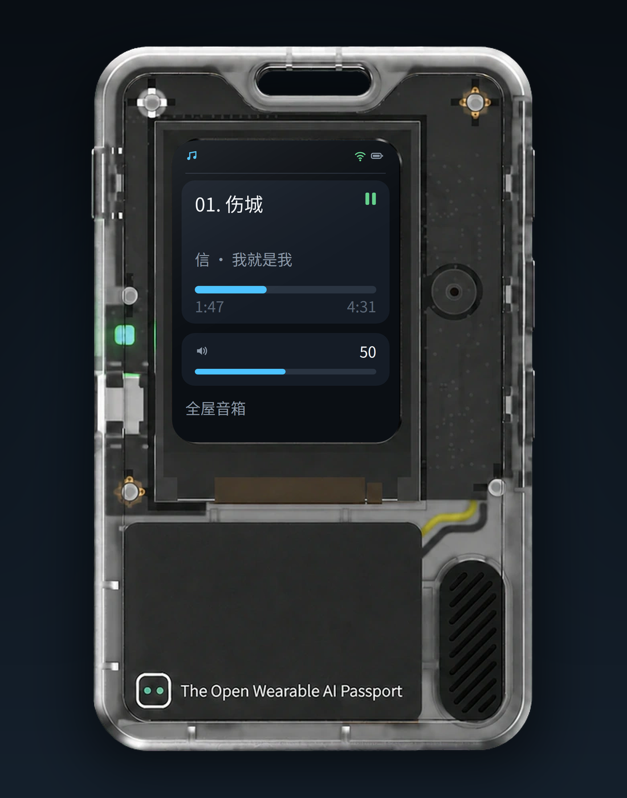

<p align="right">
  <a href="README.zh_CN.md">简体中文</a> · <strong>English</strong>
</p>

# AI Passport Music Assistant Remote

A dedicated Music Assistant remote built on the FoloToy AI Passport (ESP32-C3).
The device is a controller only: it shows what is playing, sends transport and
volume commands, and supports push-to-talk voice requests through a local bridge.
It does not decode or play music.

> [!IMPORTANT]
> **Scope:** The AI Passport firmware itself provides only basic playback
> control: play/pause, previous/next and volume. Voice requests are recorded on
> the device, but intent handling runs on the backend bridge. The bridge
> currently supports only simple lookups (artist or playlist names, plus random
> playback); more complex voice commands require editing
> `bridge/intent_prompt.txt`.

<p align="center">
  
</p>

## Features

- 240x320 Now Playing UI: title, artist, album, progress, playback state, volume
  and battery.
- Three key controls: short OK play/pause, UP/DOWN volume in 5% steps, long
  UP/DOWN previous/next; hold OK for 0.8 s for push-to-talk with a live mic
  waveform. Players that report no volume use an estimated `~N` target.
- SoftAP first-boot setup: an open `Passport-XXXX` AP serves a form at
  `http://192.168.4.1` for 2.4 GHz WiFi, MA host/port/token and bridge host/port.
- LAN voice bridge: Home Assistant Assist STT (Nabu Casa Cloud, local Whisper,
  Wyoming, OpenAI-compatible or Azure), DeepSeek intent parsing and MA playback.
- Player auto-resolution on boot and screen wake; idle dim, screen off and deep
  sleep with key wake. A connected USB host blocks deep sleep.
- OTA app updates over the LAN from a browser, using two app slots. The first
  OTA-capable image needs one USB flash; later updates keep NVS settings.

## Screenshots

<p align="center">
  
</p>

*UI mockup: the 240x320 Now Playing screen rendered from the firmware layout.*

## Repository layout

- `main/`: application UI, configuration, MA client, WiFi, voice client, setup
  portal and OTA server.
- `components/bsp/`: FoloToy board support (display, buttons, audio, battery).
- `bridge/`: Python voice bridge and deployment documentation.
- `assets/fonts/`: Noto Sans CJK SC subset (OFL) and the generation script.
- `docs/`: hardware and development references.

## Firmware build

Requires ESP-IDF 5.5.3.

```bash
source ~/esp/esp-idf-v5.5.3/export.sh
idf.py --ccache build
idf.py merge-bin
```

The partition table has two OTA app slots (`ota_0`/`ota_1`). Flash the merged
image at `0x0` over USB once; after that, use the OTA page for updates:

```bash
python -m esptool --chip esp32c3 -p /dev/ttyACM0 -b 460800 \
  write_flash 0x0 build/merged-binary.bin
```

A blank NVS enters the setup AP. `./tools/validate.sh --firmware` also builds
and verifies a merged image under `build/firmware/<sha>/`.

No compile-time secrets are required. `main/secrets.h` is an optional,
gitignored development file; the setup AP collects runtime configuration.

## First boot

1. Connect to the open `Passport-XXXX` AP and open `http://192.168.4.1`.
2. Fill in the 2.4 GHz WiFi credentials, the MA host/port and a dedicated MA
   token, and the bridge host/port.
3. Save; the device reboots, connects to WiFi and starts polling MA.

The MA token is stored in NVS. Use a dedicated, minimally scoped token rather
than an admin token. To re-enter setup, erase NVS with `esptool erase_flash`
and then flash the merged image at `0x0`.

## OTA updates

While connected to WiFi, the device serves an upload page on port 80:

1. Find the device address in the router's DHCP list (hostname
   `Passport-XXXX`) or in the `OTA page: http://...` serial log line.
2. Open `http://<device-ip>/`.
3. Choose the app-only image `build/FoloToy-AI-Passport.bin` and upload it.

The device writes the inactive OTA slot, verifies the image, switches the boot
partition and reboots; NVS settings such as WiFi and MA configuration are
preserved. Do not upload `build/merged-binary.bin` (that file also contains the
bootloader and partition table). The OTA page has no authentication and is
intended for a trusted LAN only.

## Voice bridge

See `bridge/README.md`; `.env.example` documents the Home Assistant, MA,
DeepSeek and STT provider settings. Keep the bridge on a trusted LAN.

- A Home Assistant Assist pipeline with STT (Nabu Casa Cloud or local Whisper)
  and a long-lived HA token.
- A Music Assistant API token.
- A DeepSeek API key, used only by the bridge; never place it on the device.

`MA_PLAYER_ID` is optional: the bridge auto-selects the playing player, then a
paused player with media, then the first usable player.

## Security

Do not commit `main/secrets.h`, `bridge/.env`, `bridge/secrets/` or build output.
Use dedicated tokens and rotate them if they are exposed. The setup AP is open
only while provisioning. The bridge does not authenticate the device, so do not
expose it directly to the internet.

## License and attribution

The firmware is based on the FoloToy AI Passport project (MIT; see `LICENSE`).
The bridge code is distributed under the same license. Noto Sans CJK SC is
licensed under the SIL Open Font License 1.1; see `assets/fonts/OFL.txt`.
