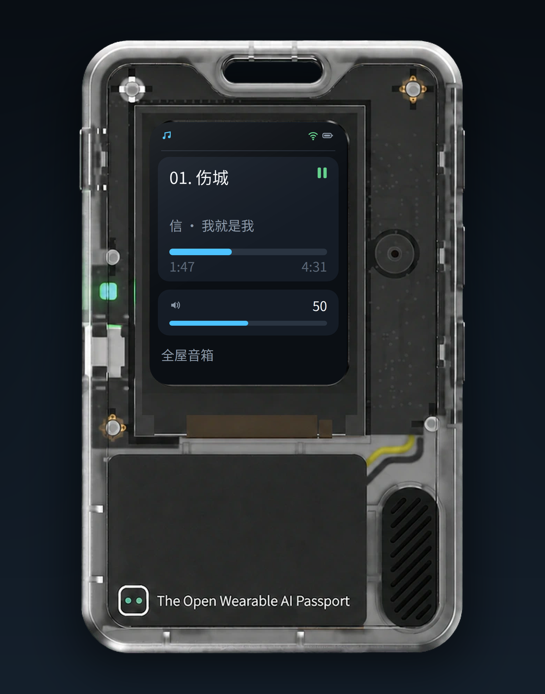

<p align="right">
  <strong>简体中文</strong> · <a href="README.md">English</a>
</p>

# AI Passport Music Assistant 遥控器

基于 FoloToy AI Passport（ESP32-C3）的 Music Assistant 专用遥控器。设备只做控制器：
显示当前播放内容、发送播放/音量和切歌命令，并通过局域网 bridge 支持按住说话。
设备本身不解码、不播放音乐。

> [!IMPORTANT]
> **功能边界：** AI Passport 固件本身只提供简单的播放控制：播放/暂停、切歌和音量。
> 语音请求由设备录音，但意图解析和播放决策在后台 bridge 中完成。bridge 目前支持
> 歌手、专辑、单曲、流派和歌单查找，以及随机播放和语音随机播放；更复杂的语音指令需要
> 自行修改 `bridge/intent_prompt.txt`。

<p align="center">
  
</p>

## 功能

- 240×320 Now Playing 界面：歌名、歌手、专辑、进度、播放状态、音量和电量。
- 三键操作：短按 OK 播放/暂停，上/下音量按 5% 步进，长按上/下上一首/下一首；
  长按 OK 0.8 秒进入按住说话，屏幕显示麦克风波形。无音量反馈的设备用 `~N` 表示估算值。
- 首次开机 SoftAP 配网：开放热点 `Passport-XXXX`，浏览器打开
  `http://192.168.4.1`，填写 2.4GHz WiFi、MA 地址/端口/token、bridge 地址/端口。
- 局域网语音 bridge：Home Assistant Assist STT（Nabu Casa Cloud、本地 Whisper、
  Wyoming、OpenAI 兼容接口或 Azure）、DeepSeek 意图解析和 MA 播放。
- 开机和亮屏唤醒时自动解析播放器；空闲调暗、熄屏、按键唤醒深睡；连接 USB 主机时不深睡。
- 局域网浏览器 OTA 升级，使用双 app 分区。首次需要 USB 烧录一次，之后升级保留 NVS 配置。

## 界面截图

<p align="center">
  
</p>

*界面示意图：按固件布局渲染的 240×320 Now Playing 界面。*

## 目录结构

- `main/`：应用 UI、配置、MA 客户端、WiFi、语音客户端、配网页面和 OTA 服务。
- `components/bsp/`：FoloToy 板级支持（显示、按键、音频、电量）。
- `bridge/`：Python 语音 bridge 和部署文档。
- `assets/fonts/`：Noto Sans CJK SC 子集（OFL）和生成脚本。
- `docs/`：硬件和开发参考资料。

## 固件构建

需要 ESP-IDF 5.5.3。

```bash
source ~/esp/esp-idf-v5.5.3/export.sh
idf.py --ccache build
idf.py merge-bin
```

分区表包含两个 OTA app 分区（`ota_0`/`ota_1`）。先用 USB 把合并镜像烧到
`0x0` 一次；之后通过 OTA 页面升级：

```bash
python -m esptool --chip esp32c3 -p /dev/ttyACM0 -b 460800 \
  write_flash 0x0 build/merged-binary.bin
```

NVS 为空时会进入配网 AP。`./tools/validate.sh --firmware` 也会构建并校验一个
合并镜像，产物在 `build/firmware/<sha>/`。

构建不需要内置任何密钥。`main/secrets.h` 只是可选的、被 gitignore 的开发文件；
运行时配置由配网 AP 收集。

## 首次开机

1. 连接开放热点 `Passport-XXXX`，打开 `http://192.168.4.1`。
2. 填写 2.4GHz WiFi、MA 地址/端口和专用 MA token、bridge 地址/端口。
3. 保存后设备重启、连接 WiFi 并开始轮询 MA。

MA token 保存在 NVS；请使用最小权限的专用 token，不要使用 admin token。
需要重新配网时，先用 `esptool erase_flash` 擦除，再把合并镜像烧到 `0x0`。

## OTA 升级

设备连接 WiFi 后会在 80 端口提供升级页面：

1. 在路由器 DHCP 列表里找到设备地址（主机名 `Passport-XXXX`），或看串口日志里的
   `OTA page: http://...`。
2. 浏览器打开 `http://<设备IP>/`。
3. 选择 app 镜像 `build/FoloToy-AI-Passport.bin` 上传。

设备会写入非当前 OTA 分区、校验镜像、切换启动分区并重启；WiFi、MA 等 NVS
配置会保留。不要上传 `build/merged-binary.bin`（它还包含 bootloader 和分区表）。
OTA 页面没有鉴权，只应在可信局域网使用。

## 语音 bridge

见 `bridge/README.zh_CN.md`；`.env.example` 记录了 Home Assistant、MA、DeepSeek
和 STT provider 的配置。bridge 只放在可信局域网。

- 配好 STT 的 Home Assistant Assist pipeline（Nabu Casa Cloud 或本地 Whisper）
  和长期访问 token。
- Music Assistant API token。
- DeepSeek API key，只放在 bridge 上，不要放进设备。

`MA_PLAYER_ID` 可省略：bridge 会先选正在播放的播放器，其次是有媒体的暂停播放器，
最后是第一个可用播放器。

## 安全

不要提交 `main/secrets.h`、`bridge/.env`、`bridge/secrets/` 或构建产物。
使用专用 token；如果泄露要及时轮换。配网 AP 只在配网时开放。bridge 目前不校验设备，
不要直接暴露到公网。

## 许可与归属

固件基于 FoloToy AI Passport 项目（MIT；见 `LICENSE`）。bridge 代码使用同一许可。
Noto Sans CJK SC 使用 SIL Open Font License 1.1；见 `assets/fonts/OFL.txt`。
